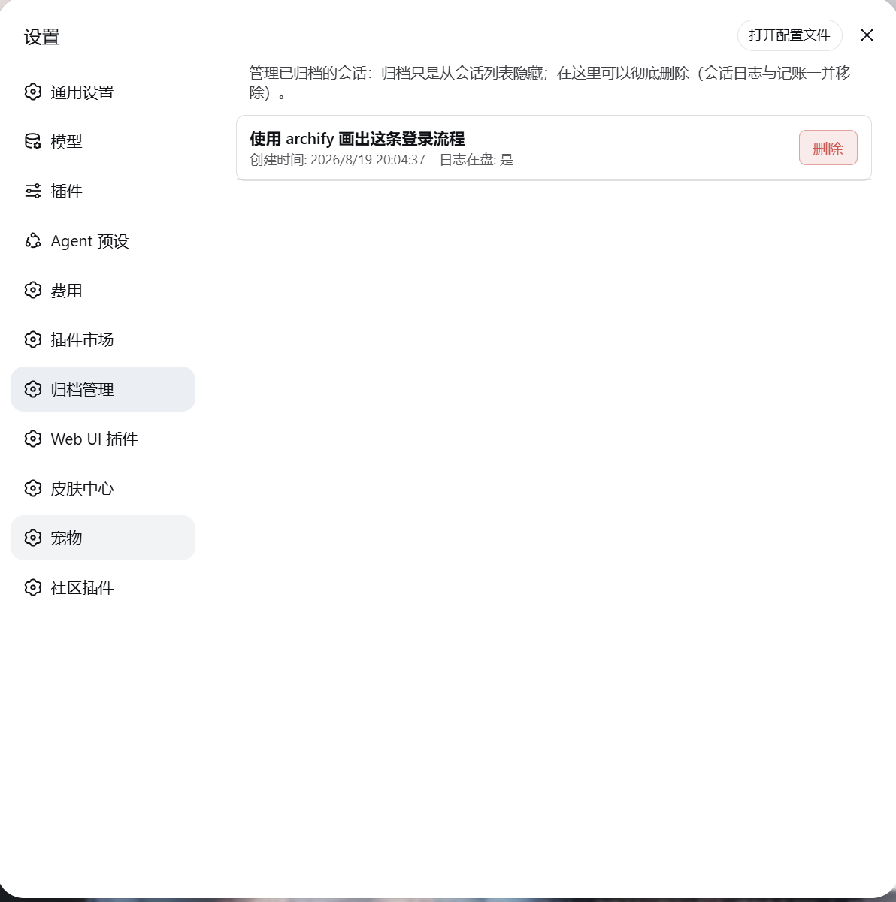

# dsh-archive-manager-plus

Delete DeepSeek Harness sessions from the session menu, or manage archived sessions in Settings. Deletion removes the session log and related records; archiving alone only hides the session.

English | [中文](README.zh.md)

[](https://www.npmjs.com/package/dsh-archive-manager-plus)
[](https://github.com/MS666666/dsh-archive-manager)
[](LICENSE)

## Compatibility

**Plugin 0.1.8 targets DeepSeek Harness v0.2.2-rc.1.** It uses the new native context-menu service and handles the updated session publication states. The legacy v0.2.1-rc.5 menu fallback remains, but the full runtime checks for this release target v0.2.2-rc.1.

All **20 tests pass**, including three integration tests using pinned official Harness components. They cover native menu registration, stopping an active Agent turn, workspace synchronization, plain and zstd log deletion, projection-cache cleanup, and recreating the host from persisted data. Other sessions and historical cost records are preserved.

The desktop Electron interface has not been manually verified. Session teardown uses version-specific host internals, so compatibility with other Harness versions is not assumed. See the [compatibility report](https://github.com/MS666666/dsh-archive-manager/blob/main/docs/compatibility-0.2.2-rc.1.md) for the exact scope and reproduction steps.

## Features

- **Delete session** in the session row's `⋯` menu, with confirmation before any change.
- **Settings → Archive Manager**: list archived sessions with their title, creation time, and log availability; restore or permanently delete them.
- Stop running work and release the session's writer and in-memory state before deleting its log.
- Remove workspace membership and notify the native sidebar session feed.
- Keep persistent deletion receipts and clean up stale archive records or late cache writes that would otherwise bring deleted entries back.
- Require same-origin POST requests and validate session IDs before filesystem operations.



## Installation

### Add Plugin — recommended

1. Open DeepSeek Harness → **Settings → Plugins → Add Plugin**. Depending on the UI locale, plugin management may also be available from the sidebar.
2. Enter the npm package spec:

   ```text
   dsh-archive-manager-plus@0.1.8
   ```

3. Complete installation, then fully quit Harness, including its tray process, and reopen it once to load both plugin halves.

To install the newest npm release later, enter `dsh-archive-manager-plus` or use the host's plugin update action. For a local build, enter the **absolute path** to `dsh-archive-manager-plus-0.1.8.tgz`, without surrounding quotes in the input field.

### Install from source on Windows

Clone or download this repository, then run the script from its root:

```powershell
powershell -NoProfile -ExecutionPolicy Bypass -File .\install.ps1 -DryRun
powershell -NoProfile -ExecutionPolicy Bypass -File .\install.ps1
```

For a custom Harness home:

```powershell
.\install.ps1 -DSHHome "D:\path\to\dsh-home" -DryRun
.\install.ps1 -DSHHome "D:\path\to\dsh-home"
```

| Parameter | Behavior |
|---|---|
| `-ProfileDir <path>` | Explicit profile directory; takes priority over home detection. |
| `-DSHHome <path>` | Explicit home, then `DSH_HOME`, then `~/.dsh`. |
| `-ProfileName <name>` | Select a profile; otherwise detect `desktop` first, then `web`. |
| `-DryRun` | Preview without changing files. |
| `-SkipCopy` | Update only the profile manifest; the plugin files must already be installed. |

The script copies the plugin files, registers its dependency and bundle, and verifies the profile manifest with Node. Manifest writes use UTF-8 without BOM. It keeps a manifest backup and restores that backup if final manifest verification fails; this does **not** provide rollback for deleted sessions.

### Manual profile setup

If the host's plugin manager is unavailable, install into the intended profile directory:

```powershell
cd "<profile-directory>"
npm install dsh-archive-manager-plus@0.1.8
```

Ensure that profile's `package.json` contains the dependency and bundle entry below. Merge them into the existing manifest; do not replace other dependencies or bundles.

```json
{
  "dependencies": {
    "dsh-archive-manager-plus": "0.1.8"
  },
  "dsh": {
    "profile": {
      "bundles": ["dsh-archive-manager-plus"]
    }
  }
}
```

Save without a UTF-8 BOM, then fully quit and reopen Harness. Installing into an unrelated project directory does not activate a Harness plugin.

## Usage

**Direct deletion:** session row → `⋯` → **Delete session** → confirm. Confirmation archives the target, stops its running work, releases it, and deletes its log and related records. Canceling the dialog makes no changes.

**Archive management:** open **Settings → Archive Manager**. Use **Restore** to unarchive a session without deleting its log, or **Delete** to remove it permanently after confirmation.

Deletion is irreversible. If loading, publication, or saving is still in progress, the plugin may refuse deletion and show an error. If a later step fails, the session may remain archived; retry or inspect it in Archive Manager. Existing deletion receipts apply to sessions deleted by versions that recorded them; a leftover entry from an older version may need to be deleted once more.

## Data affected

Deletion releases the loaded Agent and session, closes the log writer, and removes:

- The session directory under `<DSH_HOME>/sessions/<encoded-workspace>/<session-id>/`.
- Its archive/pin markers and workspace membership through the live registry.
- Its current per-session projection-cache record and any legacy cache entry.
- Its cached host index entries, followed by a native sidebar removal notification.

The plugin records deleted IDs in `<DSH_HOME>/storages/archive-manager-deleted.json` to repair stale state or late projection-cache writes. It does not scan for and automatically delete unrelated session logs. Historical cost ledgers are not removed.

Do not include credentials, usernames, machine-specific paths, or private conversation content in public issues.

## Development and verification

Requires a Node version compatible with the target Harness. Verification for 0.1.8 used Node 24 and official v0.2.2-rc.1 packages.

```powershell
npm run setup:integration
npm test
npm run test:integration
```

The setup command installs locked test dependencies into `.compat-runtime` inside this repository. Tests use temporary data directories and an offline model adapter; they do not touch the user's Harness home or call paid models. Without these dependencies, the three official-component integration tests are explicitly skipped; a run with skipped tests is not the full release validation.

`client/client.js` is a handwritten browser module bundle; `lib/` contains the host ESM modules. No build step is required. Restart the host after host-side changes.

Before publishing, run the complete tests and `npm publish --dry-run`. Publish the same version from `package.json` to npm and create the matching GitHub tag/release.

## License

[MIT](LICENSE)
