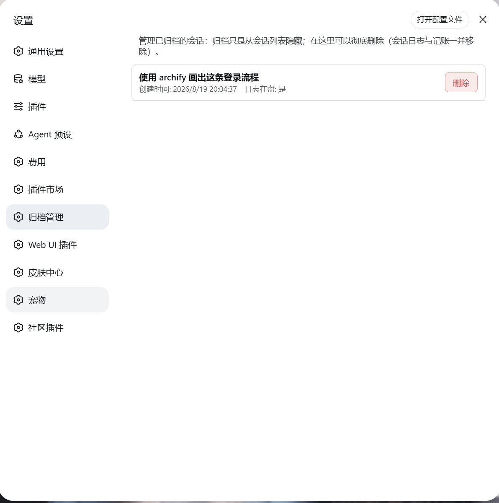

# dsh-archive-manager-plus

在 DeepSeek Harness 会话菜单中直接删除会话，或在设置页管理已归档会话。删除会清理会话日志及关联记录；归档本身只是隐藏会话。

[English](README.md) | 中文

[](https://www.npmjs.com/package/dsh-archive-manager-plus)
[](https://github.com/MS666666/dsh-archive-manager)
[](LICENSE)

## 兼容性

**插件 0.1.8 针对 DeepSeek Harness v0.2.2-rc.1 适配。** 使用新版原生菜单服务，并处理新版会话发布状态。保留 v0.2.1-rc.5 的旧菜单降级路径，但本版本完整运行验证以 v0.2.2-rc.1 为准。

**20 项测试全部通过**，其中 3 项集成测试使用锁定版本的官方 Harness 组件，覆盖原生菜单注册、停止运行中的 Agent 回合、工作区同步、普通及 zstd 日志删除、投影缓存清理，以及从持久数据重建宿主。测试确认其他会话及费用历史记录得到保留。

尚未手动验收桌面 Electron 界面。会话释放依赖目标版本的部分内部结构，不默认保证其他 Harness 版本的兼容性。完整范围及重现方法见 [适配报告](https://github.com/MS666666/dsh-archive-manager/blob/main/docs/compatibility-0.2.2-rc.1.md)。

## 功能

- 会话行 `⋯` 菜单新增 **删除会话**，确认前不改动会话。
- **设置 → 归档管理**：展示归档会话的标题、创建时间、日志是否在盘，支持还原和永久删除。
- 删除前停止运行中的任务，释放日志写入器和内存会话。
- 清理工作区成员记录，并通知原生侧栏同步移除会话。
- 保存持久删除记录，清理旧状态或延迟缓存写入带回的残留项。
- 修改操作要求同源 POST，并在文件操作前严格校验会话 ID。



## 安装

### 添加插件（推荐）

1. 打开 DeepSeek Harness → **设置 → 插件 → 添加插件**。部分界面也可从侧栏进入插件管理。
2. 输入 npm 包名及版本：

   ```text
   dsh-archive-manager-plus@0.1.8
   ```

3. 完成安装后，完全退出 Harness（包括托盘进程），再重新打开一次，让宿主端和浏览器端代码同时生效。

以后安装 npm 最新版本可输入 `dsh-archive-manager-plus`，或使用宿主的插件更新入口。安装本地构建时，在输入框填写 `dsh-archive-manager-plus-0.1.8.tgz` 的**绝对路径**，不要加引号。

### Windows 源码安装

克隆或下载本仓库，在仓库根目录执行：

```powershell
powershell -NoProfile -ExecutionPolicy Bypass -File .\install.ps1 -DryRun
powershell -NoProfile -ExecutionPolicy Bypass -File .\install.ps1
```

使用自定义 Harness 数据目录时：

```powershell
.\install.ps1 -DSHHome "D:\path\to\dsh-home" -DryRun
.\install.ps1 -DSHHome "D:\path\to\dsh-home"
```

| 参数 | 行为 |
|---|---|
| `-ProfileDir <path>` | 显式指定 profile 目录，优先于数据目录探测。 |
| `-DSHHome <path>` | 依次使用显式参数、`DSH_HOME` 环境变量、`~/.dsh`。 |
| `-ProfileName <name>` | 指定 profile；未指定时优先识别 `desktop`，其次 `web`。 |
| `-DryRun` | 仅预览，不修改文件。 |
| `-SkipCopy` | 仅更新 profile manifest，插件文件须已安装。 |

脚本复制插件文件、注册依赖与 bundle，并使用 Node 校验 profile manifest。JSON 使用 UTF-8 无 BOM 写入；保留 manifest 备份，最终 manifest 校验失败时恢复备份。此机制**不提供已删除会话的回滚**。

### 手动配置 profile

宿主插件管理器不可用时，可在目标 profile 目录中安装：

```powershell
cd "<profile-directory>"
npm install dsh-archive-manager-plus@0.1.8
```

确保该 profile 的 `package.json` 包含下面的依赖与 bundle 条目。应合并到现有配置中，不要覆盖其他依赖或 bundle。

```json
{
  "dependencies": {
    "dsh-archive-manager-plus": "0.1.8"
  },
  "dsh": {
    "profile": {
      "bundles": ["dsh-archive-manager-plus"]
    }
  }
}
```

保存为 UTF-8 无 BOM，完全退出并重新打开 Harness。在无关项目目录执行 npm 安装，不会自动激活 Harness 插件。

## 使用

**直接删除：** 会话行 → `⋯` → **删除会话** → 确认。确认后先归档目标会话、停止运行任务，再释放会话并清理日志及关联记录。取消确认框不会改动会话。

**管理归档：** 进入 **设置 → 归档管理**。点击 **还原** 取消归档并保留日志；点击 **删除**，确认后永久清理。

删除不可撤销。如果会话仍在加载、发布或保存，插件可能拒绝删除并显示原因。后续步骤失败时，会话可能保留在归档状态，可重试或进入归档管理查看。持久删除记录只适用于已记录的删除；旧版留下的残留项，可能需要升级后再删除一次。

## 数据处理范围

删除会释放已加载的 Agent 和会话、关闭日志写入器，并清理：

- `<DSH_HOME>/sessions/<encoded-workspace>/<session-id>/` 下的会话目录。
- 通过实时注册表移除归档、置顶标记及工作区成员记录。
- 当前逐会话投影缓存，以及旧版缓存中的对应条目。
- 宿主索引中的对应会话，并发送原生侧栏移除通知。

已删除的 ID 保存在 `<DSH_HOME>/storages/archive-manager-deleted.json`，用于校正旧状态与延迟投影缓存写回。插件不会扫描并自动删除其他会话日志，**不删除历史费用流水**。

请勿在公开 issue 中包含凭据、用户名、本机具体路径或私有会话内容。

## 开发与验证

需要使用目标 Harness 支持的 Node 版本。0.1.8 的验证环境为 Node 24 和官方 v0.2.2-rc.1 组件。

```powershell
npm run setup:integration
npm test
npm run test:integration
```

准备命令将锁定的测试依赖安装到本仓库的 `.compat-runtime`。测试使用临时数据目录和离线模型适配器，不访问用户的 Harness 数据目录，也不调用付费模型。未安装集成依赖时，3 项官方组件测试会明确跳过；包含跳过项的结果不等同于完整发布验证。

`client/client.js` 为手写浏览器模块 bundle，`lib/` 为宿主 ESM 模块，无构建步骤。修改宿主代码后需重启宿主。

发布前执行完整测试及 `npm publish --dry-run`。以 `package.json` 的相同版本发布到 npm，并创建对应 GitHub tag/release。

## 许可

[MIT](LICENSE)
